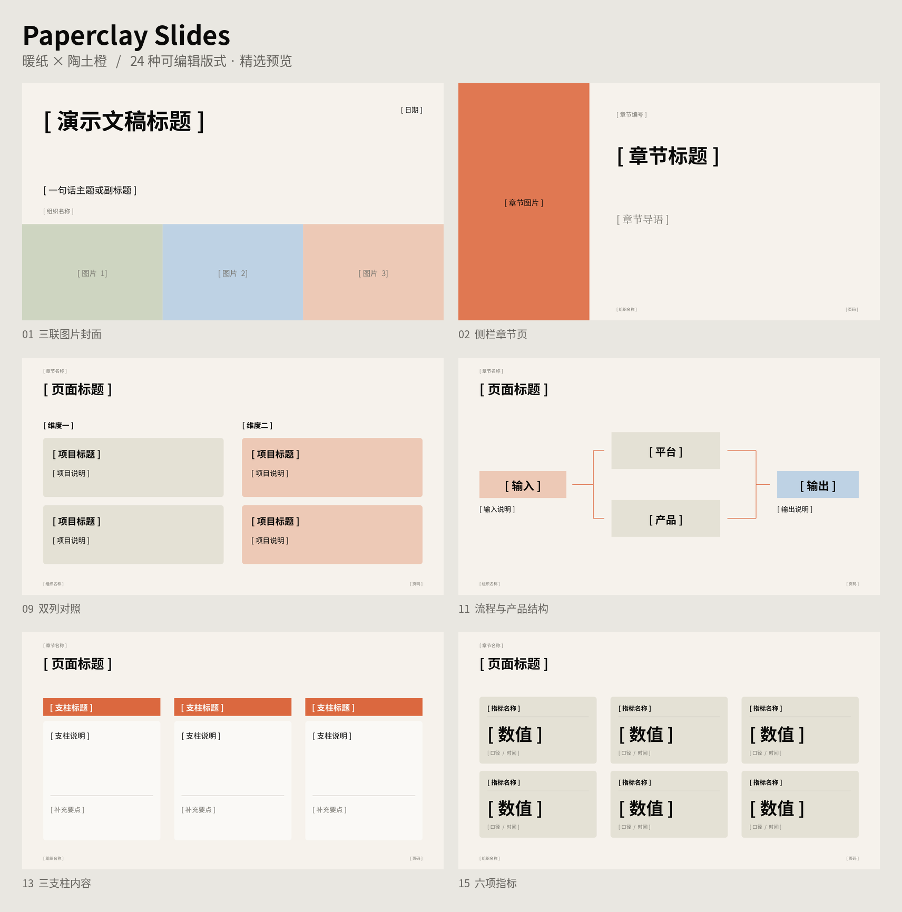

# Paperclay Slides

**纸陶幻灯：用暖纸、陶土橙和克制排版制作可编辑演示文稿。**

Paperclay Slides 将一份路演 PDF 的视觉规则提炼为 24 种占位符版式，并提供 Python 脚本，将结构化内容填入模板、生成原生表格和图表、检查文件结构及渲染预览。



## 内容

- `assets/paperclay.pptx`：24 页占位符模板，可在 PowerPoint 等演示软件中编辑。
- `assets/paperclay.potx`：PowerPoint 模板格式，用于从模板新建演示文稿。
- `assets/layouts.json`：版式 ID、字段名、位置、类型与文本长度限制。
- `assets/tokens.json`：配色、画布、字体和间距。
- `scripts/`：内容填充、模板查看、文件检查及预览工具。
- `references/`：设计规范、制作指南和来源说明。
- `SKILL.md`：供 AI 助手调用的制作流程。

占位符模板包含原生内容占位符、占位提示与必要的排版结构。用户提供的参考 PDF、原照片、商标、水印和业务数据不随项目分发。

## 快速开始

进入包含 `SKILL.md`、`assets/`、`scripts/` 的技能目录后执行以下命令。将路径替换为本地实际位置，内容文件可以放在任意项目目录。

```bash
cd /path/to/paperclay-slides
python3 scripts/inspect_template.py --layout three_rows
```

将下面内容保存为 `content.json`：

```json
{
  "title": "项目进展",
  "footer": "项目组",
  "slides": [
    {
      "layout": "cover",
      "text": {
        "title": "项目进展",
        "subtitle": "本周工作与下一步"
      }
    },
    {
      "layout": "three_rows",
      "text": {
        "title": "本周工作",
        "heading_1": "需求梳理",
        "body_1": "整理已确认需求并明确验收方式。",
        "heading_2": "功能实现",
        "body_2": "按优先级实现本轮约定功能。",
        "heading_3": "交付准备",
        "body_3": "检查文档、演示和待处理问题。"
      },
      "notes": "示例文字，请替换为项目的实际进展。"
    }
  ]
}
```

```bash
python3 scripts/compose_deck.py --spec content.json --output output/deck.pptx
python3 scripts/audit_deck.py --input output/deck.pptx
```

仅需要空白模板时，复制 `assets/paperclay.pptx`，直接在演示软件中填写。

## 生成预览

安装 [LibreOffice](https://www.libreoffice.org/download/download-libreoffice/)，确保它能从命令行调用，再安装 Python 渲染依赖：

```bash
python3 -m pip install PyMuPDF Pillow
python3 scripts/render_preview.py --input output/deck.pptx --output-dir output/preview
```

预览目录包含 PDF、逐页 PNG 和 `contact_sheet.png`。逐页检查标题折行、中文字形、图片裁切、表格和图例；成稿前再用最终演示软件查看关键页。

## 工具

| 脚本 | 用途 | 常用参数 |
| --- | --- | --- |
| `inspect_template.py` | 查看模板及版式字段 | `--layout`、`--input`、`--output` |
| `compose_deck.py` | 按 JSON 生成 PPTX | `--spec`、`--output`、`--template`、`--catalog` |
| `audit_deck.py` | 检查关系、越界和遗留占位提示 | `--input`、`--output`、`--allow-placeholders` |
| `render_preview.py` | 导出 PDF、PNG 与拼图 | `--input`、`--output-dir`、`--width`、`--columns` |

核心脚本使用 Python 3.10+ 标准库。渲染需要 LibreOffice 和 PyMuPDF，拼图另外使用 Pillow。自动检查提供结构检查与近似文本容量判断，最终排版仍需查看渲染结果。

## 内容输入

每页使用一个版式 ID，必须提供 `text.title`。文字、图片、表格和图表分别放入 `text`、`images`、`tables`、`charts`。图片路径相对内容 JSON 所在目录。

原生表格使用 `headers` 与 `rows`。原生图表支持分组竖柱图 `bar` 和折线图 `line`，使用 `categories` 与 `series`，并内嵌可编辑数据工作簿。详细示例见技能目录中的 `references/authoring-guide.md`。

脚本默认拒绝未知字段和过长文本，保持模板字号。内容过密时，缩短重复文字、选择更宽版式或拆页。省略的可选文字会清空，省略的媒体占位对象会移除。

## 版式

| 内容类型 | 版式 ID |
| --- | --- |
| 封面与章节 | `cover`、`section_image`、`agenda`、`statement`、`section_dark` |
| 文本与关系 | `three_rows`、`team`、`comparison`、`architecture`、`process`、`hub_spoke`、`three_columns`、`strategy_rows`、`appendix_text` |
| 图表与指标 | `text_chart`、`chart_triptych`、`metric_grid`、`kpi_chart`、`trend`、`chart_kpis`、`chart_full` |
| 表格与摘要 | `summary_table`、`table_callout`、`native_table` |

查看准确字段：

```bash
python3 scripts/inspect_template.py --layout chart_full
```

## 作为技能使用

在支持本地 Agent Skills 的工具中，将整个技能目录放入该工具规定的技能位置，保留 `SKILL.md`、`assets/`、`scripts/` 和 `references/` 的相对结构。支持技能包导入的界面可使用提供的安装入口。

调用示例：

> 使用 Paperclay Slides 制作 8 页项目汇报。采用暖纸与陶土橙风格，使用我提供的数据，保留原生图表和可编辑文本。先组织每页主题，再生成 PPTX 与逐页预览。

## 字体与设计来源

模板使用 `Noto Sans CJK SC` 和 `Noto Serif CJK SC`。字体文件单独从 [Noto CJK 官方仓库](https://github.com/notofonts/noto-cjk) 安装。

视觉参考是用户提供的 57 页栅格路演 PDF。原始字体无法从该文件确认，所用字体为视觉近似。配色来自视觉采样与重建。Paperclay Slides 为独立制作的通用模板，来源说明见 `references/provenance.md`。

## 许可证

原创代码、说明和占位符模板使用 MIT 许可证，见 `LICENSE`。外部字体与用户加入的素材遵循各自许可证。
